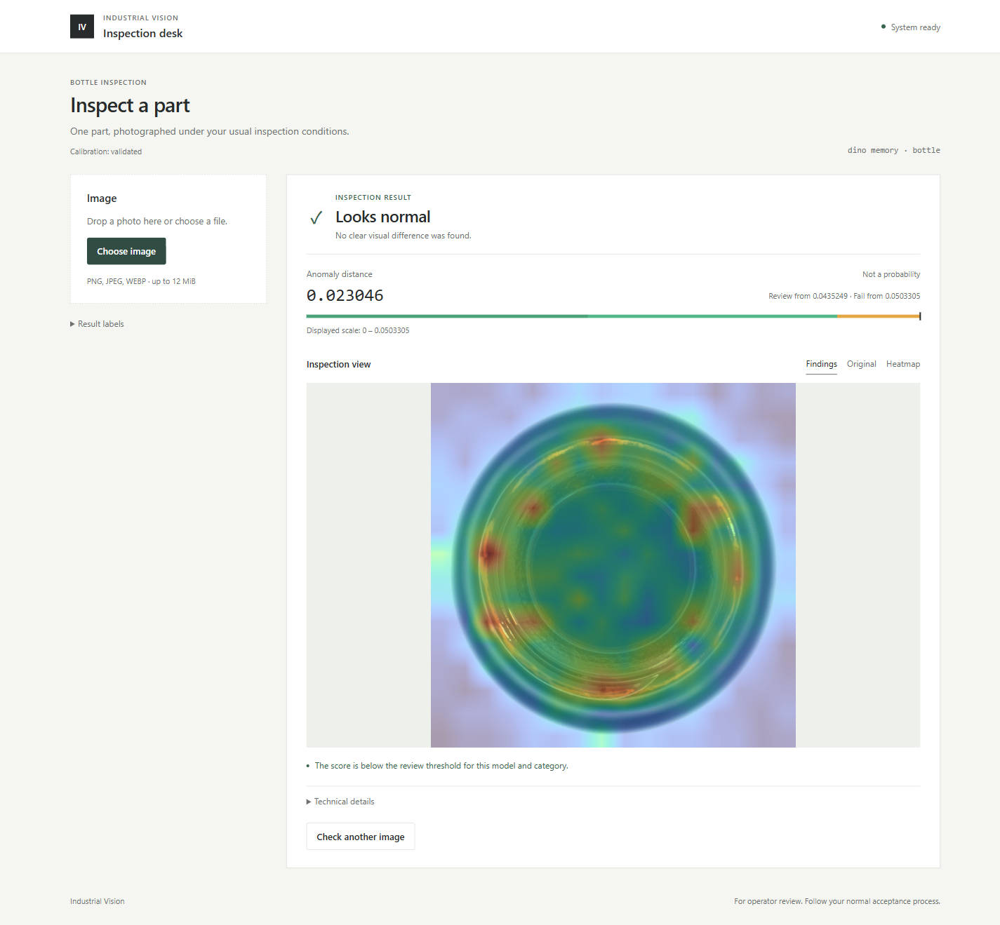
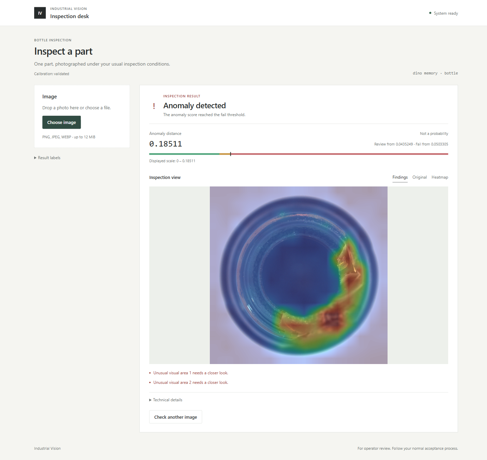

# Industrial Visual Inspection

A computer-vision project for inspecting images and comparing anomaly-detection
models. It provides a local web interface, REST API and CLI for scores, heatmaps,
PASS/REVIEW/FAIL decisions and saved inspection reports.

The project supports Classical Diff, PatchCore, EfficientAD, DINOv3 memory and a
local SuperADD runtime. It builds on [Anomalib](https://github.com/open-edge-platform/anomalib)
and the [PatchCore method](https://github.com/amazon-science/patchcore-inspection).

## Example inspections

These screenshots show DINOv3 memory inspecting previously used MVTec AD bottle
examples. The first image was classified as normal; the second was classified
as anomalous. The colored overlay highlights the model's anomaly signal.

| Normal example | Defect example |
|---|---|
|  |  |

The corresponding input photographs are in [assets/showcase](assets/showcase/).
Images are from [MVTec AD](https://www.mvtec.com/research-teaching/datasets/mvtec-ad)
by MVTec Software GmbH; the photographs and screenshots containing modified
versions are shared under [CC BY-NC-SA 4.0](https://creativecommons.org/licenses/by-nc-sa/4.0/).
These two examples illustrate the interface, not independent model evaluation.

## Results and performance

Image-level AUROC on the reused MVTec AD bottle test set (83 images):
Classical Diff **0.862**, PatchCore **1.000**, EfficientAD **1.000** and
DINOv3 memory **0.998**. These are exploratory benchmark results, not an
independent evaluation. On MVTec LOCO `splicing_connectors` (312 images),
SuperADD achieved image AUROC **0.758** and defect recall **55.4%**.

On the separate Ron88 bottle set (300 test images), DINOv3 achieved image
AUROC **0.816** but falsely flagged **100 of 121** normal images at the
validation-selected threshold. Results therefore depend strongly on the dataset
and operating threshold.

On Windows 11 with an NVIDIA GeForce RTX 5090 Laptop GPU, the Ron88 DINOv3
experiment recorded **72.1 ms mean / 81.5 ms p95** per image across 300 test
predictions. This measures the model prediction path, not an end-to-end HTTP
request. In a separate single local run, starting the service until `/ready`
took **41.9 s**, and the first HTTP inspection, including evidence writing,
took **14.7 s**. These startup and first-request numbers are single observations,
not steady-state benchmarks; they vary with the machine and environment. The
normal example in that API run was incorrectly flagged, consistent with the
high false-positive rate above.

- [Installation and launch](docs/RUN.md)
- [Experiment results](docs/RESULTS.md)

Datasets and model weights are separate assets; a fresh clone does not contain a
ready-to-use detector. Results are exploratory and depend on the image domain.
